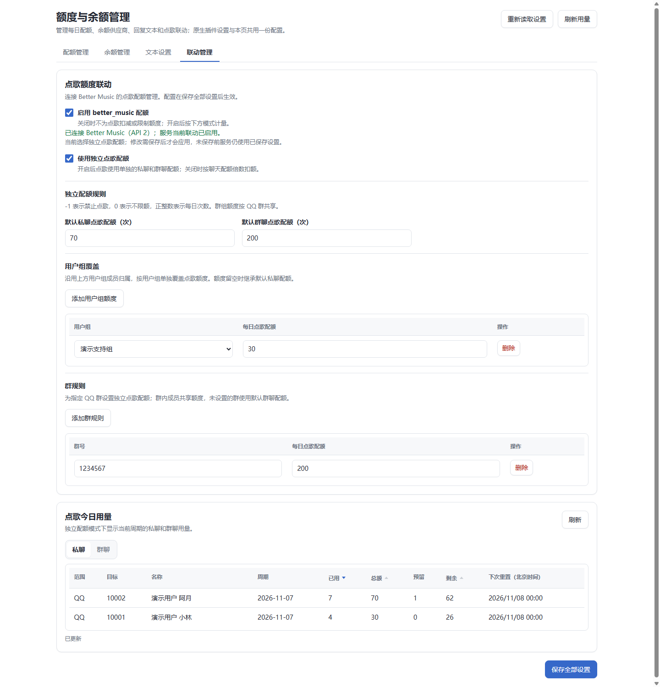
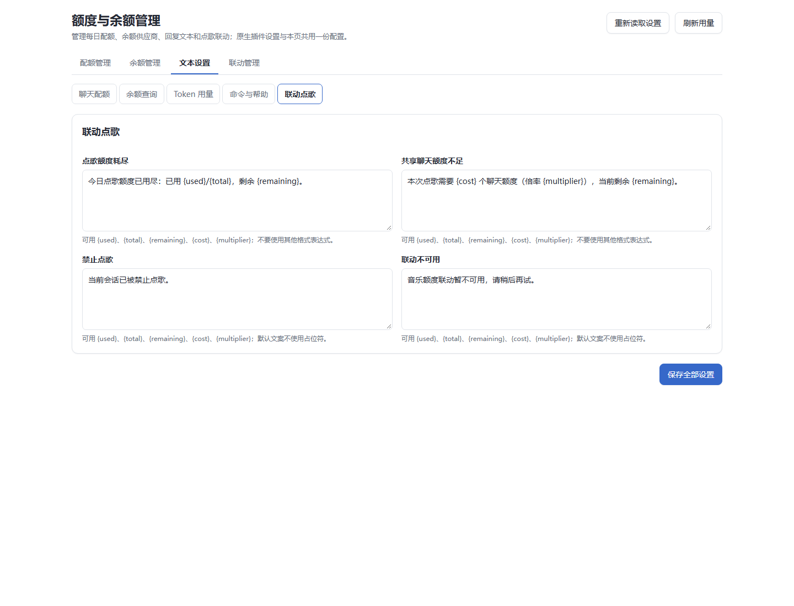

# 更好的额度管理

更好的额度管理是面向 AstrBot QQ（aiocqhttp）机器人的插件，可设置每日私聊与群聊额度、查询模型供应商余额和全局 Token 用量，并可选接入 Better Music 点歌额度。

- 版本：1.0.0
- 适用版本：AstrBot 4.29.3 及以上
- 平台：aiocqhttp
- [下载发布包](https://github.com/Nortea575/astrbot_plugin_better_balance/releases) · [源码仓库](https://github.com/Nortea575/astrbot_plugin_better_balance) · [问题反馈](https://github.com/Nortea575/astrbot_plugin_better_balance/issues) · [更新日志](CHANGELOG.md)
- 许可证：[GPL-3.0-only](LICENSE)

## 界面预览

下图使用演示数据，仅展示管理页布局和配置项。

## 主要功能

- 为私聊用户、用户组成员和 QQ 群设置每日聊天额度，并查看今日用量。
- 查询 DeepSeek、Kimi、OpenRouter、阿里云 BSS、火山引擎和 NewAPI 等供应商余额，也可配置自定义余额接口。
- 查看 AstrBot 已记录的全局 Token 用量。
- 选择将点歌额度计入聊天额度，或单独管理点歌额度。
- 在管理页编辑聊天额度、余额查询、Token 用量、命令与帮助、点歌联动五类回复文本。

## 快速开始

1. 在 AstrBot 插件管理中使用[源码仓库](https://github.com/Nortea575/astrbot_plugin_better_balance)安装；也可以从[发布页](https://github.com/Nortea575/astrbot_plugin_better_balance/releases)下载发布包，并将插件放入 AstrBot 的 `data/plugins/astrbot_plugin_better_balance` 目录。
2. 重启 AstrBot。
3. 打开“拓展功能 → 更好的额度管理”，设置聊天额度、余额供应商或回复文本。保存后配置生效。
4. 在 QQ 中使用命令。命令前缀跟随 AstrBot 的唤醒词或命令前缀；例如前缀配置为 `%A` 时，发送 `%A配额`。

## 聊天额度

默认私聊额度为每天 70 次，群聊额度为每天 200 次。私聊额度按用户分别计算；群额度由群内成员共享。属于用户组的成员各自使用该用户组的额度。可以为特定 QQ 群另设额度。

聊天额度按成功交付的 LLM 回复计数；开启共享点歌额度后，成功点歌也按设置的倍率计入聊天额度。失败、未完成的回复不会计数；AstrBot 的 `/help`、`/sid` 等系统命令以及本插件的配额查询不扣额度。额度值 `0` 表示不限额，`-1` 表示禁止该用户、用户组或群发起 LLM 请求。每日周期按北京时间计算，重置时刻可配置。

“今日用量”页面会将私聊和群聊分开展示，并支持按已用、总额或剩余额度排序。若 QQ 用户名或群名暂时无法获取，页面会显示“暂未获取”。

## 命令

命令前缀以 AstrBot 的当前设置为准。

| 命令 | 用途 |
| --- | --- |
| `配额` | 查看当前私聊或群的额度状态 |
| `帮助` | 查看本插件命令用法 |
| `余额 所有` | 查询所有已配置的供应商余额 |
| `余额 当前` | 查询当前会话绑定的余额记录 |
| `余额 <别名>` | 查询指定余额记录 |
| `余额 用量 1天`、`余额 用量 3天`、`余额 用量 1周` | 查看对应时间范围内的全局 Token 总量 |

余额和 Token 用量命令可由 QQ 会话中的成员使用；Token 用量是全局汇总，不按 QQ 用户拆分。查询命令不调用 LLM。管理页配置仅供已登录的 AstrBot 管理员使用。

## 供应商余额与 Token 用量

在管理页的余额供应商中，为每条记录设置唯一别名并填写所需的查询凭证。OpenRouter 需要 Management Key；阿里云 BSS 和火山引擎需要云账号 Access Key，并且该账号必须有相应的 BSS 或账单查询权限。DeepSeek、Kimi、NewAPI 和自定义接口可配置查询凭证或引用现有 AstrBot 单 Key 供应商。

NewAPI 记录可查询账户或令牌额度，并可选择按站点配置显示单位，或固定为人民币、美元及站点原始额度。账户查询权限不足时会明确报错，不会自动改查令牌额度；不限额令牌会显示为“不限额”。扫描只读取本地供应商配置，不会探测网络，也不会自动判断某个 OpenAI 兼容服务是否为 NewAPI。

“自定义（OpenAI 来源）”和“自定义（Anthropic 来源）”是自定义接口配置类型，不会自动调用 OpenAI 或 Anthropic 官方余额接口，也不会从模型 API 地址推导余额地址。使用这两种类型或自定义 HTTP 时，需要填写实际可用的余额 URL、认证信息和 JSON Pointer 响应字段映射。

全局 Token 用量取决于 AstrBot 已记录的请求。没有进入 AstrBot 统计记录的请求（例如直接调用 Provider 的请求）不会计入。

## Better Music 点歌额度联动

联动总开关和独立额度模式默认关闭。启用前需要安装提供 **Music quota API v2** 的 Better Music；插件管理页会显示检测到的接口是否兼容、是否已连接。仅凭 Better Music 的版本号无法确认当前安装包带有 v2 接口，请以管理页状态为准：[Better Music 源码仓库](https://github.com/Nortea575/astrbot_plugin_better_music)。

开启联动后可选两种额度方式：

- **共享聊天额度**：点歌使用聊天额度，按设置的倍率计入；倍率为大于等于 1 的整数，默认 1。
- **独立点歌额度**：与聊天额度分开统计，默认私聊每天 70 次、群聊每天 200 次；可以按已有用户组归属覆盖私聊额度，也可以为指定群设置共享额度。`0` 表示不限额，`-1` 表示禁止点歌。

标准点歌和主动翻唱会触发额度判定；菜单、搜索和管理页手动发送不计入。联动判定本身不调用 LLM。点歌请求会先预留额度；尚未成功发送任何音频时失败或取消，才会释放预留。首段音频成功发送即结算，后续分段不会重复计数。关闭联动后，新请求不再经过外部额度判定，已预留的请求仍会按最终结果结算或释放。

独立点歌额度沿用本插件设置的北京时间重置时刻；Better Music 自身的自然日统计仍单独计算。

## 回复文本

管理页可按聊天额度、余额查询、Token 用量、命令与帮助、点歌联动五类编辑回复文本。字段旁会标出可用占位符；文本只支持列出的占位符，不支持任意格式表达式。AstrBot 原生插件设置与管理页共用同一份配置；升级时会保留已有设置、用量记录和自定义回复文本。
